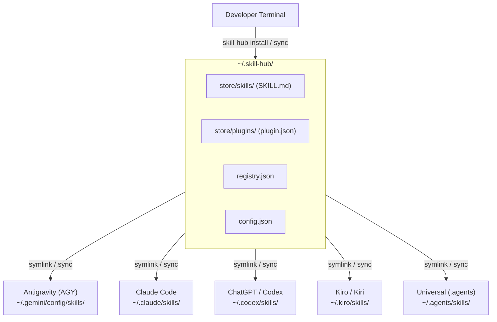

# ⚡ skill-hub

> **Universal Skill and Plugin Hub for Multi-Agent AI Workflows**  
> Share and synchronize skills, rules, and plugins across **AGY (Antigravity)**, **Claude Code**, **ChatGPT / Codex**, **Kiro / Kiri**, and **Universal OpenAgents** with a single command.

---

## 🎯 Why skill-hub?

Modern developers frequently switch between multiple AI tools on the same machine:
- **AGY (Antigravity CLI & IDE)** (`~/.gemini/config/skills/`)
- **Claude Code** (`~/.claude/skills/`)
- **ChatGPT / Codex CLI** (`~/.codex/skills/`)
- **Kiro / Kiri / Kimi** (`~/.kiro/skills/`)
- **Universal Agent Standard** (`~/.agents/skills/`) (Goose, Devin, Muse, OpenCode, Cline, Roo Code, pi)

Managing your custom prompt skills, tools, and plugins across all these directories manually leads to stale configurations, duplication, and headaches.

With **`skill-hub`**, you maintain a single, canonical hub:
```bash
# Install once from any Git repo, GitHub shorthand, or local path
skill-hub install DietrichGebert/ponytail

# Or synchronize everything in 1 command
skill-hub sync
```
Every agent on your machine instantly gains access to your skills and plugins!

---

## 🏗️ Architecture



---

## 🚀 Quickstart

### 1. Installation
Run the installer:
```bash
cd /Users/monaliza/Documents/niigata/skill-hub
./install.sh
```
Or symlink it manually to your PATH:
```bash
ln -sf /Users/monaliza/Documents/niigata/skill-hub/bin/skill-hub ~/.local/bin/skill-hub
```

### 2. Verify AI Tools Detection
Run `doctor` to see what AI agents are installed on your computer:
```bash
skill-hub doctor
```
Output:
```text
=== Skill-Hub System Diagnostics ===

Hub Home:             ~/.skill-hub
Sync Mode:            symlink
Auto-Sync:            True

Target AI Agent Tools Status:
AGENT TOOL                     DETECTED  SKILLS DIR                             SKILLS COUNT
Antigravity (AGY)              YES       ~/.gemini/config/skills                16
Claude Code                    YES       ~/.claude/skills                       0
ChatGPT / Codex                YES       ~/.codex/skills                        0
Kiro / Kiri                    YES       ~/.kiro/skills                         0
Universal OpenAgent (.agents)  YES       ~/.agents/skills                       0
```

### 3. Share Existing Skills Across All Tools
Already have skills in AGY (or elsewhere)? Import them into the hub with one command:
```bash
skill-hub import --from agy
```
`skill-hub` will automatically import them into your central hub and distribute them to **Claude Code**, **ChatGPT/Codex**, and **Kiro**!

---

## 💻 Commands

### `skill-hub install <source>`
Install a skill or plugin from any source:
```bash
# From GitHub shorthand
skill-hub install DietrichGebert/ponytail

# From full Git repository URL
skill-hub install https://github.com/my-org/custom-research-skill.git

# From a local directory
skill-hub install /path/to/local-skill

# From a single markdown file
skill-hub install ./analysis.md --name data-analyzer

# From curated registry
skill-hub install deep-research
```
*Note: Unless `--no-sync` is specified, `install` automatically syncs across all enabled AI tools.*

---

### `skill-hub sync`
Synchronize all installed skills and plugins to all agent directories:
```bash
skill-hub sync
```
Options:
- `--mode symlink|copy`: Use zero-storage symlinks (default) or hard copies.
- `--targets agy,claude,chatgpt,kiro`: Target specific agents.
- `--scope project --workspace .`: Sync into the current project workspace (`.agents/skills`, `.claude/skills`).

---

### `skill-hub list`
Display all installed skills and plugins, their source, and version:
```bash
skill-hub list
```

---

### `skill-hub create <name>`
Scaffold a new universal agent skill with standard YAML frontmatter:
```bash
skill-hub create code-simplifier --description "Refactor complex code into clean, readable functions"
```
It creates the skill in `~/.skill-hub/store/skills/code-simplifier/SKILL.md` and immediately syncs it to all agents.

---

### `skill-hub search [query]`
Search the curated catalog of verified skills and plugins:
```bash
skill-hub search
skill-hub search research
```

---

### `skill-hub uninstall <name>`
Unlink and remove a skill or plugin from the hub and all agent directories:
```bash
skill-hub uninstall my-old-skill
```

---

### `skill-hub config`
Inspect and customize behavior:
```bash
# View configuration
skill-hub config show

# Change sync mode to copy instead of symlink
skill-hub config set sync_mode copy

# Configure enabled targets
skill-hub config set enabled_targets agy,claude,chatgpt,kiro
```

---

## 🧩 Supported AI Tools & Folder Mapping

| AI Agent | Target Skills Directory | Target Plugins Directory | Workspace Scope |
| :--- | :--- | :--- | :--- |
| **Antigravity (AGY)** | `~/.gemini/config/skills/` | `~/.gemini/config/plugins/` | `.agents/skills/` |
| **Claude Code** | `~/.claude/skills/` | `~/.claude/plugins/` | `.claude/skills/` |
| **ChatGPT / Codex** | `~/.codex/skills/` | `~/.codex/plugins/` | `.codex/skills/` |
| **Kiro / Kiri** | `~/.kiro/skills/` | `~/.kiro/plugins/` | `.kiro/skills/` |
| **Universal Agents** | `~/.agents/skills/` | `~/.agents/plugins/` | `.agents/skills/` |

---

## 🧪 Testing

Run the test suite:
```bash
python3 -m unittest discover -s tests -v
```

---

## 📄 License
MIT License. Free to use, share, and customize.
